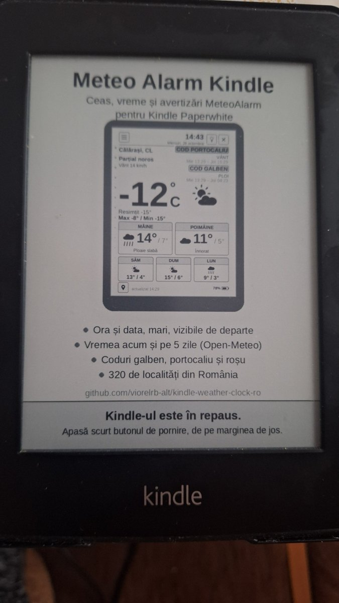
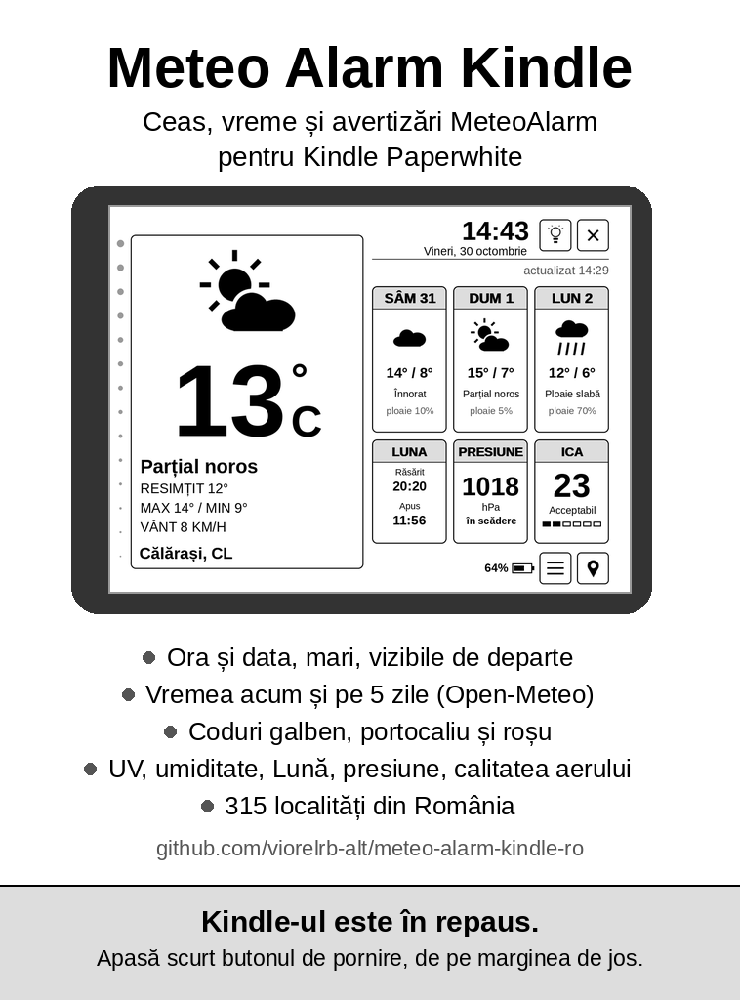

# Meteo Alarm Kindle Screensaver

A small KUAL extension for a jailbroken **Kindle Paperwhite 1** that turns off the "Special Offers" lock screen ads and shows a **Meteo Alarm Kindle** screen instead. It also keeps the Kindle's own clock on Romanian time, summer and winter. After one setup step it runs by itself at every start.

It is the companion of [Meteo Alarm Kindle](https://github.com/viorelrb-alt/meteo-alarm-kindle-ro), a weather clock with MeteoAlarm warnings for the same Kindle.

<p>
  
  
  
</p>

*Left: the new lock screen on the real Kindle. Middle: the image itself. Right: the lock screen before.*

**Version 1.4** · [Download the zip](download/MeteoAlarmKindle-screensaver-v1.4.zip?raw=1) · [Română](#în-limba-română)

## What is new in 1.4

- The lock screen image shows Meteo Alarm Kindle **v2.062** in landscape, with the new Moon / Pressure / AQI boxes.
- The feature list under the picture is updated: UV, humidity, Moon, pressure and air quality; 315 towns.
- The GitHub address on the image is now `meteo-alarm-kindle-ro`.
- A new `screensaver.png` is put in place by itself at the next start, once step 3 was run one time. Copy the folder over the old one and reboot (sometimes twice).
- `tools/make_screensaver.py` also takes landscape screenshots (1024x758).

## What it does

| KUAL menu item | What happens |
|---|---|
| 1. Verifică | Writes `raport.txt` with the ad settings, screensaver files, time zone and free space. Changes nothing. |
| 2. Elimină reclamele | Backs up `appreg.db`, sets `adunit.viewable=false` and empties the downloaded ads. |
| 3. Pune ecranul Meteo Alarm Kindle | Backs up the stock screensavers once, then replaces them with `screensaver.png`. |
| 4. Repară la fiecare pornire | Installs two upstart jobs. At every start they turn the ads off, block new ad downloads, load the normal screensaver instead of the ads one, and fix the time zone (EET / EEST). |
| Anulează tot | Undoes all of the above and puts the original images back. |

Reboot the Kindle after steps 2, 3 and 4. Every step writes to `raport.txt`.

## Install

1. You need a **jailbroken** Kindle Paperwhite 1 (tested: firmware 5.6.1.1) with **KUAL**.
2. Download the zip and copy the `extensions` folder to the root of the Kindle.
3. Open KUAL > **Ecran de repaus și reclame** and run steps 1 to 4, then reboot.

To hide the entry from KUAL afterwards (it keeps working at every start), remove `<menus>` from `config.xml` and set `menu.json` to `{"items": []}`. Do not delete the folder: the start-up job uses it.

## Why it is needed on firmware 5.6.1.1

- Turning off `adunit.viewable` alone does not last: after a reboot with Wi-Fi on, it comes back and a new ad is downloaded. So the fix runs at every start.
- The lock screen is drawn by the `ad_screensaver` module of `blanket`. The start-up job unloads it and loads the normal `screensaver` module.
- The interface keeps its own UTC offset as text (`GMT+03:00`) in `tzVar` and in the framework prefs (`device.tz.lasttz`). A job that runs before the framework sets the right offset for Romanian summer or winter time.

## Your own image

`tools/make_screensaver.py` (Python + Pillow) draws the 758x1024 gray image from a screenshot of Meteo Alarm Kindle:

```
python3 tools/make_screensaver.py screen.png extensions/ecranrepaus/screensaver.png
```

## Warning

This changes system files of the Kindle and turns off Amazon's Special Offers. Jailbreaking voids the warranty. Do it at your own risk. "Anulează tot" restores the backups.

## Credits

Jailbreak learned from the [Oak Reef guide](https://oakreef.ie/bog/kindle-jailbreaking). Thanks to KindleModding, the MobileRead forums and NiLuJe (FBInk). Design, ideas and testing on the Kindle: the project owner (Romania). Code: Claude (Anthropic's AI assistant).

## License

[MIT](LICENSE).

---

## În limba română

**Ecran de repaus** oprește reclamele de pe ecranul de blocare al unui Kindle Paperwhite 1 cu jailbreak și pune în locul lor un ecran Meteo Alarm Kindle. Ține și ceasul Kindle-ului pe ora României, de vară și de iarnă.

Nou în 1.4: imaginea arată Meteo Alarm Kindle v2.062 în peisaj (Lună / Presiune / ICA), lista e actualizată, iar o imagine nouă se pune singură la următoarea pornire, dacă pasul 3 a fost rulat o dată.

Instalare: copiezi folderul `extensions` din arhivă în rădăcina Kindle-ului. Apoi, din KUAL > „Ecran de repaus și reclame”, rulezi pașii 1–4 și repornești Kindle-ul. După pasul 4 totul rulează singur la fiecare pornire. „Anulează tot” pune totul la loc.

Poți ascunde intrarea din KUAL: scoate `<menus>` din `config.xml` și golește `menu.json`. Nu șterge folderul, îl folosește jobul de pornire. Detalii în `extensions/ecranrepaus/CITESTE.txt`.
